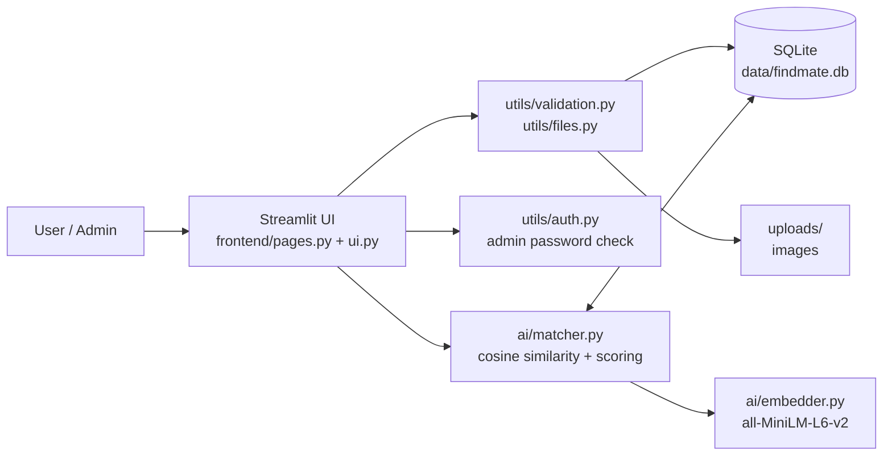
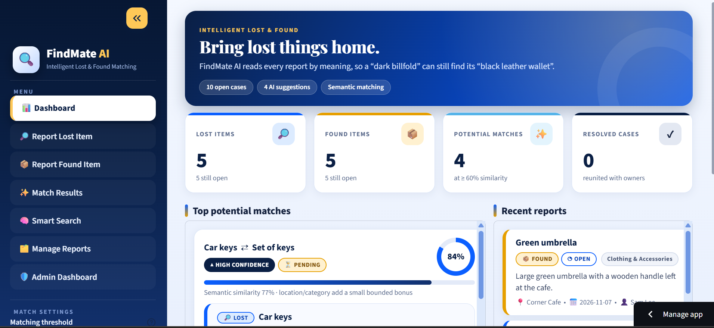

# 🔍 FindMate AI - Intelligent Lost & Found Matching

**FindMate AI reunites people with their belongings by matching lost-item and found-item reports by *meaning*, not keywords.**
A report of a *"dark billfold with a university identity card"* is matched to a *"black leather wallet with a student ID"*, even though the two descriptions share almost no words.

🌐 **Live application:** <https://findmate-ai-dhxvmhdgri3ju4fgkedida.streamlit.app/>
📦 **Source code:** <https://github.com/alpha5-rdx/findmate-ai>

---

## Table of contents

1. [Problem statement](#problem-statement)
2. [Features](#features)
3. [Technology stack](#technology-stack)
4. [AI methodology](#ai-methodology)
5. [Project architecture](#project-architecture)
6. [Installation](#installation)
7. [Admin password setup](#admin-password-setup)
8. [Usage guide](#usage-guide)
9. [Configuration](#configuration)
10. [Testing](#testing)
11. [Deploying to Streamlit Community Cloud](#deploying-to-streamlit-community-cloud)
12. [Screenshots](#screenshots)
13. [Security and privacy](#security-and-privacy)
14. [Limitations](#limitations)
15. [Future improvements](#future-improvements)
16. [Troubleshooting](#troubleshooting)

---

## Problem statement

Lost-and-found desks, campus noticeboards and social-media groups depend on exact words. The person who lost a
*"navy phone with a shattered corner"* and the person who found an *"Apple mobile, dark blue, cracked at the edge"* never
find each other because a keyword search sees two unrelated sentences.

FindMate AI solves this with **semantic matching**: it converts every description into a vector that captures its meaning
and ranks lost/found pairs by similarity, so people (and a human administrator) can quickly review the most likely matches.

## Features

| Page | What it does |
|------|--------------|
| **Dashboard** | Metric cards (lost, found, potential matches, resolved), scrollable *Top potential matches* and *Recent reports*, one-click sample dataset |
| **Report Lost / Found Item** | Validated form (item, category, description, location, date, contact details, optional photo). Matching runs on submit and the form resets for the next report |
| **Match Results** | Pairs ranked by similarity with High / Medium / Low confidence, similarity rings and a configurable threshold |
| **Smart Search** | Describe an item in plain language and get ranked results (no exact keywords needed) |
| **Manage Reports** | Look up reports by e-mail, edit them (re-matched automatically) or delete them after a confirmation dialog |
| **Admin Dashboard** | Password-protected: all reports, matches with contact details, *Mark as resolved* (with confirmation), re-open, statistics charts, CSV export |

Other details:

- Input validation on every field (3+ characters, e-mail must contain `@` and `.com`, contact number must be exactly 11 digits, no future dates, image type/size checks).
- Colour-blind-safe blue/amber design, collapsible sidebar, scrollable result lists, full-width responsive layout.
- Works fully offline after the first start (the AI model is downloaded once). No paid APIs or API keys.

## Technology stack

| Layer | Technology |
|-------|-----------|
| Language | Python 3.10+ (developed and tested on 3.13) |
| Web UI | [Streamlit](https://streamlit.io) with custom CSS |
| Embeddings | [Sentence Transformers](https://www.sbert.net) - `all-MiniLM-L6-v2` (384-dimensional) |
| Similarity | scikit-learn `cosine_similarity` |
| Data | SQLite (standard library `sqlite3`) and pandas |
| Images | Pillow (validation) and local file storage |
| Tests | pytest and Streamlit `AppTest` |

## AI methodology

1. **Embedding.** For every report the text *item name + description* is encoded by `all-MiniLM-L6-v2` into a normalised
   384-dimensional vector. Embeddings are saved in SQLite and recomputed only when a report is created or edited.
   (Category and location are deliberately *not* embedded, to avoid counting them twice.)
2. **Cosine similarity.** Every open lost report is compared with every open found report in a single matrix operation:
   `cosine_similarity(lost_vectors, found_vectors)`.
3. **Bounded metadata bonus.** Category and location refine the ranking but can never create a match on their own:

   ```
   score = semantic + 0.05 × [same category] + 0.04 × location_similarity
   ```

   - Location similarity is also semantic, so *"Central Library"* ≈ *"Main Library reading hall"*.
   - The bonus is at most 0.09, and it is ignored completely when `semantic < 0.30` (such pairs are dropped).
4. **Confidence labels.** `High ≥ 0.75`, `Medium ≥ 0.60`, otherwise `Low`. The display threshold (default 0.60) is a slider in the sidebar.
5. **Smart Search.** The query is embedded with the same model and ranked against all stored embeddings.
6. **Safety.** Missing or very short descriptions fall back gracefully, and if the model cannot be loaded the UI shows an error with recovery steps.

> ⚠ **Similarity is not proof of identity.** The score only says that two descriptions *mean* similar things.
> Always verify ownership (unique marks, contents, proof of purchase) before returning an item.

## Project architecture



```
app.py                  Streamlit entry point, sidebar navigation
config.py               Paths, model name, thresholds, categories, limits
ai/embedder.py          Model loading (once), text building, embedding cache
ai/matcher.py           Cosine matching, score combination, semantic search
database/db.py          SQLite schema (auto-created + migrated) and every query
frontend/ui.py          CSS theme and reusable components
frontend/pages.py       Page renderers and confirmation dialogs
utils/validation.py     Form validation rules
utils/files.py          Image validation and local storage
utils/auth.py           Admin password loading and verification
data/sample_data.py     Fictional demo dataset
tests/                  pytest suite (validation, auth, end-to-end page tests)
screenshots/            README screenshots (see screenshots/README.md)
.streamlit/             config.toml and secrets.toml.example
PRIVACY.md              Privacy policy (draft - see its checklist)
```

Runtime data (`data/findmate.db`, `uploads/`) is created automatically and is **git-ignored**.

## Installation

**Prerequisites:** Python 3.10 or newer, Git, and an internet connection for the first start
(dependencies and the ~90 MB AI model are downloaded once).

```bash
# 1. Clone the repository
git clone https://github.com/alpha5-rdx/findmate-ai.git
cd findmate-ai

# 2. (Recommended) create a virtual environment
python -m venv .venv
source .venv/bin/activate          # Windows PowerShell: .venv\Scripts\Activate.ps1

# 3. Install dependencies
pip install -r requirements.txt

# 4. Configure the admin password (see the next section)
cp .streamlit/secrets.toml.example .streamlit/secrets.toml     # Windows: copy ... ...
#    then edit .streamlit/secrets.toml and set your own ADMIN_PASSWORD

# 5. Run the app
streamlit run app.py
```

Open <http://localhost:8501>. The app works without step 4, but the **Admin Dashboard stays locked** until a password is configured.

## Admin password setup

The admin password is **never stored in the code**. Provide it in one of two ways (secrets take priority):

**Option A - Streamlit secrets (recommended)**

```toml
# .streamlit/secrets.toml   (git-ignored)
ADMIN_PASSWORD = "your-long-random-password"
```

**Option B - environment variable**

```bash
export FINDMATE_ADMIN_PASSWORD="your-long-random-password"      # macOS / Linux
$env:FINDMATE_ADMIN_PASSWORD = "your-long-random-password"      # Windows PowerShell
```

If neither is set, the Admin Dashboard shows a "not configured" message with these instructions and nothing can be unlocked.
The old default password used by earlier versions is **rejected on purpose**, and so is the placeholder from the example file.

> ⚠ Earlier versions shipped a built-in default password that is visible in the public Git history.
> Treat it as compromised: set a new secret on every deployment.

## Usage guide

1. **Try it quickly:** on the **Dashboard** click **Load sample dataset** to add fictional reports where the same item is described in different words.
2. **Report an item:** open **Report Lost Item** or **Report Found Item**, fill in the form (all text fields need 3+ characters, the description 10+, e-mail needs `@` and `.com`, contact number is exactly 11 digits) and submit. Potential matches appear under the form, which is cleared for the next report.
3. **Review matches:** **Match Results** lists pairs by similarity. Use the **Matching threshold** slider in the sidebar to make matching stricter or looser.
4. **Search:** **Smart Search** accepts natural language such as *"something to unlock my car, with a red tag"*.
5. **Manage your reports:** **Manage Reports** → enter the e-mail used in the report → edit, or delete (a confirmation dialog appears first).
6. **Admin:** **Admin Dashboard** → sign in → review matches with contact details, **Mark as resolved** (after confirming), re-open cases, view statistics and download a CSV. Use **Sign out of admin** when finished.

Contact details (e-mail, phone) are visible to administrators only. The administrator contacts the people involved to arrange the return.

## Configuration

| Setting | Where | Default |
|---------|-------|---------|
| Admin password | `ADMIN_PASSWORD` in Streamlit secrets, or `FINDMATE_ADMIN_PASSWORD` environment variable | *none - admin locked* |
| Model, thresholds, bonuses, categories, field limits | `config.py` | `all-MiniLM-L6-v2`, threshold 0.60, bonuses 0.05 / 0.04 |
| Theme, upload limit, usage statistics | `.streamlit/config.toml` | light theme, 5 MB, statistics off |

## Testing

```bash
pip install -r requirements-dev.txt
pytest
```

The suite covers form validation, admin-password loading (missing, blank, revoked default, secret vs. environment variable),
and end-to-end tests that open every page and log in to the Admin Dashboard using Streamlit's `AppTest`.
Tests use a temporary database, so they never touch `data/findmate.db`.

## Deploying to Streamlit Community Cloud

1. Push the repository to GitHub and create the app from `app.py`.
2. Open **App settings → Secrets** and add `ADMIN_PASSWORD = "your-long-random-password"`.
3. Reboot the app. The first start downloads the AI model, which takes a little while.

> The SQLite file and uploaded images live on the app's local disk, which on Community Cloud is **temporary**:
> data can be lost when the app restarts or is redeployed. Use external storage before relying on it for real cases
> (see [Future improvements](#future-improvements)).

## Screenshots

Real screenshots will be added to the [`screenshots/`](screenshots/) folder. The required images are listed in
[`screenshots/README.md`](screenshots/README.md).

| Screenshot | File | Status |
|------------|------|--------|
| Dashboard | `screenshots/dashboard.png` | ⏳ to be added |
| Report submission | `screenshots/report-submission.png` | ⏳ to be added |
| AI matches | `screenshots/ai-matches.png` | ⏳ to be added |
| Admin dashboard | `screenshots/admin-dashboard.png` | ⏳ to be added |

<!-- After adding the real image files, uncomment these lines and delete the table above:



-->

## Security and privacy

- Admin password comes from secrets / environment only, is compared in constant time, and is never logged or shown.
- All user-supplied text is HTML-escaped before display, SQL uses parameterised queries, and uploaded images are validated and renamed randomly.
- `.gitignore` excludes the database, uploads, `.env` files, `secrets.toml` and caches.
- See **[PRIVACY.md](PRIVACY.md)** for exactly what data is collected, who can see it, and which privacy features are still missing.

## Limitations

- **No user accounts.** Reports are managed by e-mail address without verification, and admin access is one shared password.
- **Reporter names are public** on report cards; e-mail and phone are admin-only.
- Uploaded photos are stored and shown but are **not used for matching**, and their metadata (EXIF) is not stripped.
- SQLite on temporary hosting is not durable; there is no backup, retention policy or admin delete tool yet (see [PRIVACY.md](PRIVACY.md)).
- Matching is recomputed in full after each change: fine for thousands of reports, not millions.
- English-language descriptions work best (the embedding model is English-centric).
- Google Fonts are loaded from Google's servers, which shares the visitor's IP address with Google.

## Future improvements

- Real authentication: individual accounts, e-mail verification for *Manage Reports*, admin roles and audit logs.
- Durable storage (for example PostgreSQL or cloud storage) with backups, retention rules and an admin delete / anonymise tool.
- Image similarity (CLIP-style embeddings) in addition to text, and EXIF stripping.
- Notifications by e-mail/SMS when a likely match appears.
- Multilingual embedding model, self-hosted fonts, and an in-app privacy notice with consent.
- Incremental matching and a vector index for large datasets; CI pipeline running the test suite.

## Troubleshooting

- **The model fails to download:** check your connection / proxy (`HTTPS_PROXY`) and run again. Models are cached under `~/.cache/huggingface`.
- **"No admin password is configured":** follow [Admin password setup](#admin-password-setup) and restart the app.
- **"A secrets file was found but could not be read":** `secrets.toml` has invalid TOML or was saved with a UTF-8 BOM
  (common with Windows Notepad / PowerShell `Set-Content`). Re-save it as plain *UTF-8 without BOM*.
- **Reset all data:** stop the app, then delete `data/findmate.db` and the files in `uploads/` (this removes every report).
- **Port already in use:** `streamlit run app.py --server.port 8502`.

## License

No license file has been added yet. Until one is added, all rights are reserved by the author.
